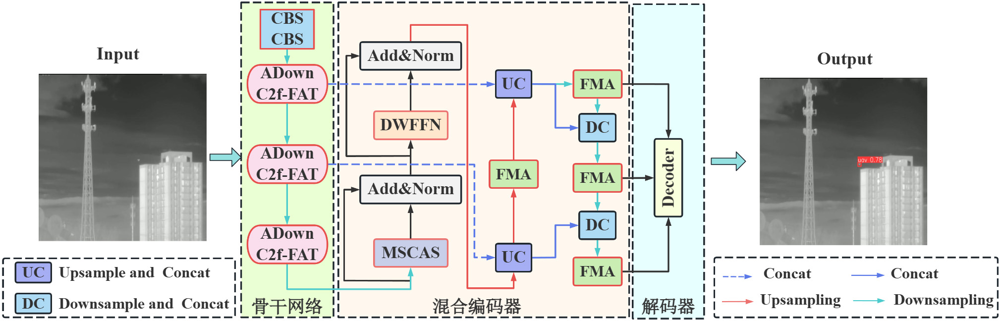

# IR-RTDETR：基于改进 RT-DETR 的红外小型无人机目标检测

<p align="center">
  <a href="https://github.com/Mr-ZHJ/IR-RTDETR/stargazers"></a>
  <a href="https://github.com/Mr-ZHJ/IR-RTDETR/network/members"></a>
  <a href="https://github.com/Mr-ZHJ/IR-RTDETR/issues"></a>
  <br><br>
  
  
  
  
  <br><br>
  
  
  
</p>

> **中文** | [English](./README.md)

一种面向复杂场景下红外小型无人机目标的检测模型。IR-RTDETR 在 RT-DETR-l 基础上，引入 **ADown + C2f-FAT** 骨干网络实现低损下采样与多尺度窗口注意力，设计 **MSCAS-AIFI** 加法自注意力模块替代传统 MHSA，并用 **FMA（快速聚合网络）** 替换 RepC3 实现轻量化跨尺度特征融合，有效解决红外小目标"尺寸极小、特征微弱、背景复杂"的检测难题。

---

## 📑 目录

- [📝 概述](#-概述)
- [✨ 核心改进](#-核心改进)
- [🏗️ 模型架构](#-模型架构)
- [📁 项目结构](#-项目结构)
- [📊 消融实验](#-消融实验)
- [🚀 实验结果](#-实验结果)
- [🔧 快速开始](#-快速开始)
  - [⚙️ 环境配置](#-环境配置)
  - [🔥 模型训练](#-模型训练)
  - [🔍 推理检测](#-推理检测)
  - [✅ 模型评估](#-模型评估)
- [📋 关键配置](#-关键配置)
- [🧩 自定义模块](#-自定义模块)
- [🗃️ 数据集](#-数据集)
- [🙏 致谢](#-致谢)
- [📜 许可证](#-许可证)

---

## 📝 概述

> 📌 **说明**：本项目为硕士毕业论文《复杂场景下小型无人机目标检测算法研究》的**第二部分（第三章）**。

红外小目标无人机检测面临"尺寸极小、特征微弱、信噪比低、背景复杂"的严峻挑战，传统检测方法难以兼顾检测精度与实时性。IR-RTDETR 通过三项关键改进解决上述问题：

1. **ADown + C2f-FAT 骨干网络** — 分路异构下采样（平均池化 + 最大池化双分支）保留红外小目标微弱特征，FAT_Block（FDWA + FMFFN）通过多尺度窗口注意力与频率调制增强小目标特征显著性。
2. **MSCAS-AIFI 编码器** — 多尺度卷积加法自注意力替代原始 AIFI 的矩阵乘法 MHSA，将复杂度从 O(N²) 降至 O(N)，在极低计算量下实现全局 Token 高效交互。
3. **FMA 快速聚合网络** — 四分支特征解耦 + 部分卷积（FastNet）替代 CCFM 中的 RepC3，实现轻量化的跨尺度特征融合，强化小目标多维度特征表达。

---

## ✨ 核心改进

| 组件 | 原始 RT-DETR | 改进方案 | 优势 |
|------|-------------|---------|------|
| 骨干下采样 | 标准 Conv (stride=2) | **ADown**：分路异构下采样（平均池化 + 最大池化双分支） | 弱化背景杂波，保留小目标边缘纹理与亮度对比度特征 |
| 骨干特征提取 | C2f | **C2f-FAT**：C2f + FAT_Block（FDWA + FMFFN） | 多尺度窗口注意力聚焦小目标区域；频率调制压制背景低频噪声 |
| 编码器注意力 (AIFI) | 多头自注意力 MHSA (O(N²)) | **MSCAS-AIFI**：多尺度卷积加法自注意力 (O(N)) | 加法 Token 混合替代矩阵乘法；MSSA + ECA 双重增强 Q/K；DropPath 增强泛化 |
| CCFM 融合块 | RepC3 | **FMA (MANet_FasterBlock)**：四分支特征解耦 + 部分卷积 | 通道级 + 空间纹理 + 原始直通分支；FastNet 部分卷积降低计算量并防止噪声扩散 |

---

## 🏗️ 模型架构



---

## 📁 项目结构

```
RTDETR/
├── train.py                          # 训练入口（FMA1.yaml + uav410sub01.yaml）
├── val.py                            # 评测脚本：输出 P/R/mAP/GFLOPs/参数量/FPS 表格
├── detect.py                         # 推理可视化
├── export.py                         # ONNX 导出
├── track.py                          # 视频跟踪
├── get_FPS.py                        # FPS/延迟基准测试
├── get_COCO_metrice.py               # COCO 指标 + TIDE 错误分析
├── get_model_erf.py                  # 有效感受野（ERF）热图
├── heatmap.py                        # GradCAM / GradCAM++ / LayerCam 可视化
├── main_profile.py                   # 逐层 profile + 模型融合
├── plot_result.py                    # 训练曲线绘制
├── requirements.txt
├── setup.py / setup.cfg
├── dataset/
│   ├── IRSTD-1K.yaml                 # IRSTD-1K 红外小目标数据集
│   ├── uav410sub01.yaml              # Anti-UAV410 红外无人机数据集（主数据集）
│   ├── split_data.py                 # 训练/验证/测试集划分工具
│   ├── xml2txt.py                    # XML → YOLO TXT 格式转换
│   └── yolo2coco.py                  # YOLO → COCO 格式转换
├── images/
│   └── framework.jpg                 # 模型整体框架图
├── ultralytics/
│   ├── cfg/models/hw-detr/FMA1.yaml  # ★ 最终模型配置
│   ├── nn/
│   │   ├── modules/                  # ultralytics 官方模块（未修改）
│   │   └── extra_modules/           # ★ 自定义改进（仅 4 个文件）
│   │       ├── block.py             #   ADown, MANet, MANet_FasterBlock, C2f_FAT, Faster_Block
│   │       ├── transformer.py       #   AIFI_CAS_att3, AdditiveTokenMixer_att3
│   │       ├── filc.py              #   FAT_Block（FDWA + FMFFN）
│   │       └── __init__.py
│   ├── models/rtdetr/               # RT-DETR 训练/验证类
│   └── utils/                         # 框架工具
└── .gitignore
```

---

## 📊 消融实验

基线：**RTDETR-R18**，数据集：**Anti-UAV410**

| 模型 | ADown+C2f-FAT | MSCAS-AIFI | FMA | P (%) | R (%) | mAP50 (%) | mAP50:95 (%) | GFLOPs | 参数量 (M) |
|-------|:---:|:---:|:---:|:-----:|:-----:|:---------:|:------------:|:------:|:----------:|
| R（基线） | | | | 91.0 | 79.2 | 81.4 | 43.79 | 56.9 | 19.87 |
| R-A | ✓ | | | 92.2 | 79.6 | 82.7 | 43.85 | 45.7 | 13.39 |
| R-A-M | ✓ | ✓ | | 95.7 | 80.8 | 84.3 | 44.52 | 45.8 | 13.47 |
| **R-A-M-F（本文）** | ✓ | ✓ | ✓ | **94.4** | **81.5** | **85.4** | **45.17** | **41.3** | **13.41** |

> **R**: RTDETR-R18 . **A**: ADown + C2f-FAT . **M**: MSCAS-AIFI . **F**: FMA

相比基线 RTDETR-R18：**mAP50:95 提升 1.38 个百分点，精确率提升 3.40 个百分点，召回率提升 2.32 个百分点**，同时**计算量降低 27.4%，参数量减少 32.5%**。

---

## 🚀 实验结果

所提模型在三个红外数据集上的性能：

| 数据集 | P (%) | R (%) | mAP50 (%) | APsmall (%) |
|--------|:-----:|:-----:|:---------:|:-----------:|
| Anti-UAV410 | 94.4 | 81.5 | 85.4 | 39.3 |
| Anti-MUAV15 | 97.6 | 96.9 | 97.2 | 63.2 |
| IRSTD-1K | 88.6 | 81.5 | 86.2 | 39.8 |

---

## 🔧 快速开始

### 环境配置

```bash
# 1. 克隆仓库
git clone https://github.com/Mr-ZHJ/IR-RTDETR.git
cd IR-RTDETR

# 2. 创建 Python 3.10+ 环境（推荐）
conda create -n irdetr python=3.10 -y
conda activate irdetr

# 3. 安装 PyTorch（CUDA 11.8）
pip install torch==2.1.1 torchvision --index-url https://download.pytorch.org/whl/cu118

# 4. 安装核心依赖
pip install -r requirements.txt

# 5. 安装额外依赖
pip install timm==1.0.7 einops grad-cam==1.5.4 \
    dill==0.3.8 albumentations==1.4.11 tidecv prettytable
```

### 🔥 模型训练

在 Anti-UAV410 数据集上训练 IR-RTDETR：

```bash
python train.py
```

或使用 ultralytics CLI：

```bash
yolo train model=ultralytics/cfg/models/hw-detr/FMA1.yaml data=dataset/uav410sub01.yaml \
    imgsz=640 epochs=100 batch=8 rect=True workers=4
```

**论文训练参数：**

模型使用 **AdamW** 优化器，初始学习率为 **0.0001**，批次大小为 **8**，输入图像尺寸为 **640×640**，训练 **100** 个轮次，开启矩形训练（rect）。

### 🔍 推理检测

```bash
python detect.py
```

### ✅ 模型评估

```bash
python val.py
```

---

## 📋 关键配置

最终模型配置位于 `ultralytics/cfg/models/hw-detr/FMA1.yaml`：

```yaml
# 骨干网络: ADown + C2f-FAT
backbone:
  - [-1, 1, Conv, [64, 3, 2]]       # P1/2
  - [-1, 1, Conv, [128, 3, 2]]      # P2/4
  - [-1, 1, C2f, [128]]
  - [-1, 1, ADown, [256]]           # P3/8  ← 改进下采样
  - [-1, 1, C2f_FAT, [256]]         # ← FAT（FDWA + FMFFN）
  - [-1, 1, ADown, [384]]           # P4/16
  - [-1, 1, C2f_FAT, [384]]
  - [-1, 1, ADown, [384]]           # P5/32
  - [-1, 3, C2f, [384]]

# Head: MSCAS-AIFI + FMA (MANet_FasterBlock)
head:
  - [-1, 1, AIFI_CAS_att3, [1024, 8]]   # ← 加法自注意力
  - [-1, 1, MANet_FasterBlock, [256]]   # ← FMA 融合（×5）
  - [[20, 23, 26], 1, RTDETRDecoder, [nc, 256, 300, 4, 8, 3]]
```

---

## 🧩 自定义模块

全部自定义改进位于 `ultralytics/nn/extra_modules/`：

| 模块 | 文件 | 类名 | 说明 |
|------|------|------|------|
| ADown | `block.py` | `ADown` | 分路异构下采样 |
| C2f-FAT | `block.py` | `C2f_FAT` | C2f + FAT_Block（窗口注意力 + 频率调制） |
| FAT_Block | `filc.py` | `FAT_Block` | FDWA + FMFFN 特征注意力块 |
| MSCAS-AIFI | `transformer.py` | `AIFI_CAS_att3` | 多尺度卷积加法自注意力 |
| AdditiveTokenMixer | `transformer.py` | `AdditiveTokenMixer_att3` | O(N) 加法 Token 混合 |
| FMA | `block.py` | `MANet_FasterBlock` | 四分支聚合 + 部分卷积 |

---

## 🗃️ 数据集

| 数据集 | 类型 | 图像数 | 目标尺寸 | 来源 |
|--------|------|--------|---------|------|
| **Anti-UAV410** | 单目标红外无人机 | 2500（子集） | 均值 1196 px²（0.36%） | [Anti-UAV](https://github.com/flying-violin/anti-uav) |
| **Anti-MUAV15** | 多目标红外无人机 | — | 均值 97 px²（0.03%） | [Anti-MUAV](https://github.com/flying-violin/Anti-MUAV) |
| **IRSTD-1K** | 通用红外小目标 | 1000 | 均值 83 px²（0.03%） | [IRSTD-1K](https://github.com/RuiZhang2016/IRSTD-1K) |

---

## 🙏 致谢

本项目基于以下开源工作：

- [RT-DETR](https://github.com/lyuwenyu/RT-DETR) — [CVPR 2024] 实时检测 Transformer
- [Ultralytics](https://github.com/ultralytics/ultralytics) — 框架与 YOLO 生态
- [Anti-UAV](https://github.com/flying-violin/anti-uav) — 红外无人机跟踪数据集
- [IRSTD-1K](https://github.com/RuiZhang2016/IRSTD-1K) — 红外小目标数据集

---

## 📜 许可证

本项目继承 Ultralytics 框架的 [AGPL-3.0 许可证](https://github.com/ultralytics/ultralytics/blob/main/LICENSE)。
